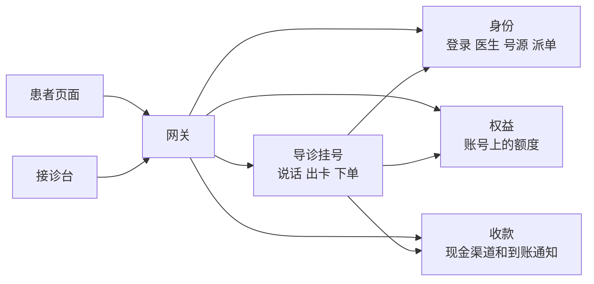
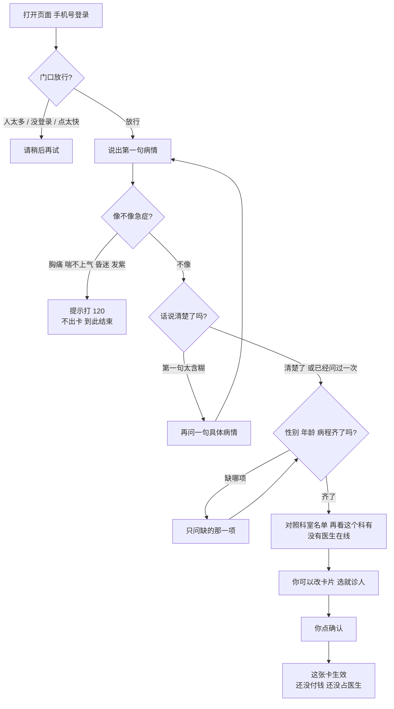
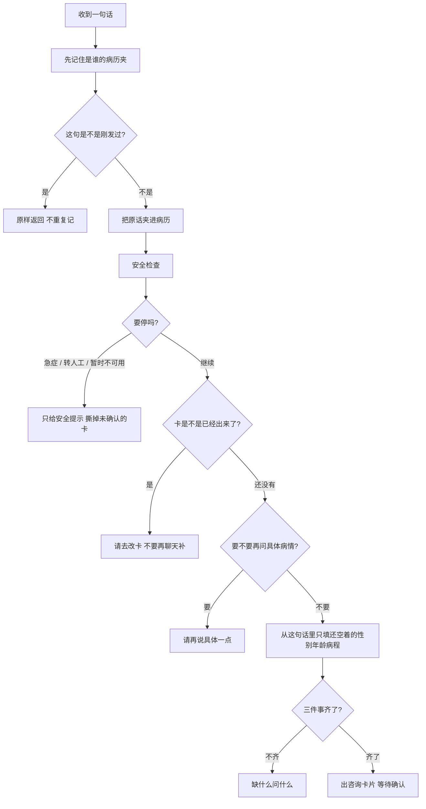
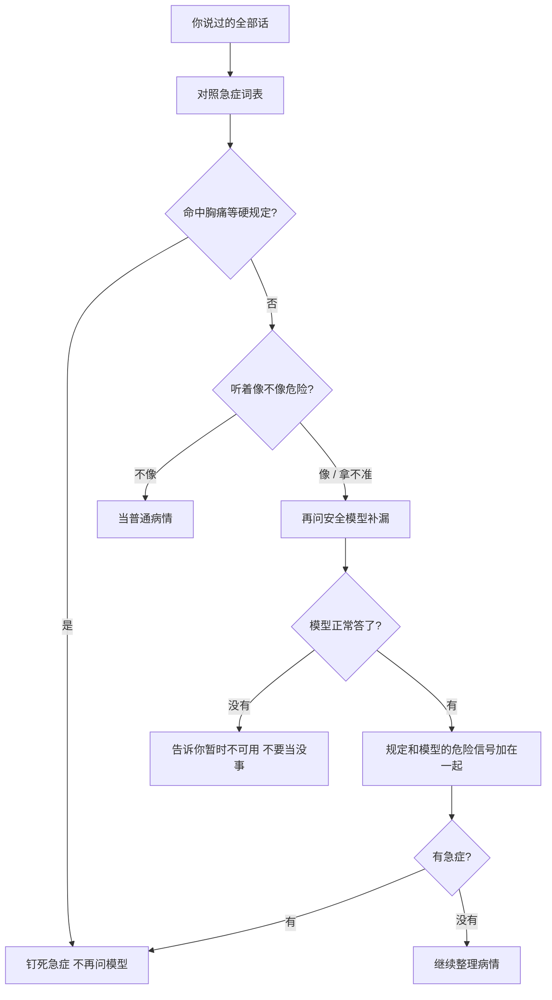
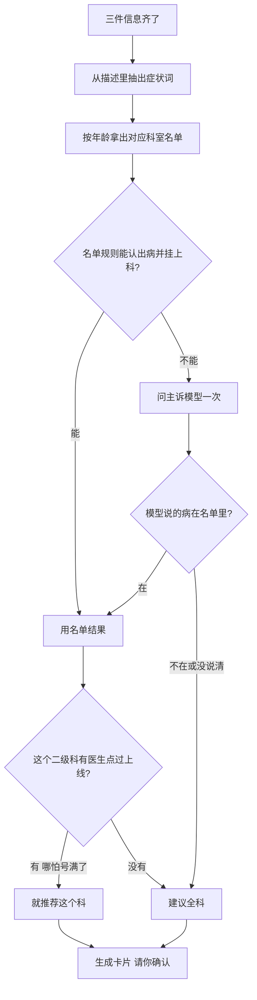
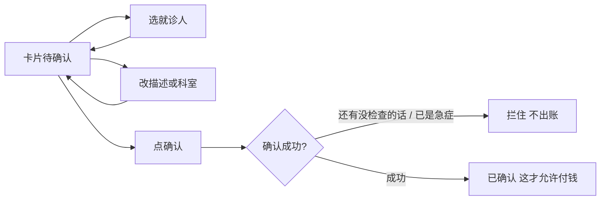
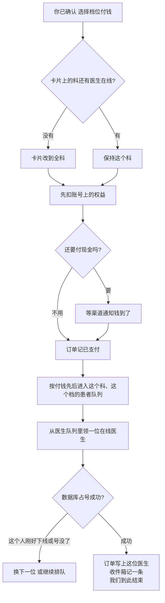

# 导诊挂号助手

患者用自然语言描述病情。系统先看是不是急症，再问清楚、推荐科室、出一张咨询卡片。你确认并付钱之后，才去占医生号、把这张单交给一位当时在线的医生。单子写上医生、医生的收件箱里有这条通知，我们这段就结束了。医生怎么回复、怎么看病，不在这条闭环里。

本仓库是 [moonligh](https://moonligh.cn/) 的个人开源项目，采用 [Apache-2.0](LICENSE) 许可证。GitHub 仓库名 `consult`。

## 一句话

**付钱之前只整理病情、不出号。付钱之后用同一张订单号扣号、派给在线医生。** 急症直接劝去打 120，不出卡。哪个二级科能被推荐，看这个科有没有医生在接诊台点过上线。

## 现在做到哪

从进门说话、出卡确认、权益抵扣或演示支付，到派给在线医生，这条链路能跑通。

- 权益挂在账号上，这个账号下的就诊人都能用。先扣权益，不够的部分再付现金。权益把整单抵完，订单直接记成已支付，马上派医生。
- 演示渠道是当场记已支付。微信、支付宝、银联有收款服务和付款通知入口；现金还没到账时，订单停在待支付，不会派医生。
- 医生在接诊台自己点上线、下线。点了上线就能接新单。点了下线，手里的单照常看完，看完不再派新单。
- 号源在我们自己的排班表里，还没接医院 HIS。不处理医保。

## 系统里有谁

患者和医生都只敲网关这一个门。网关认登录，再把请求分到后面的服务。



| 谁 | 干什么 | 端口 |
| --- | --- | --- |
| 网关 | 登录检查、人流限制、把请求送到该去的服务 | 8080 |
| 导诊挂号 | 对话、出卡、下单、权益抵扣之后发起派单 | 18081 |
| 身份 | 登录、就诊人、医生档案、排班、真正占号和派单 | 18082 |
| 收款 | 微信、支付宝、银联的下单和渠道回调 | 18083 |
| 权益 | 账号上的卡和额度，先占后确认 | 18084 |
| 患者页面 | 说话、确认、付钱 | 5173 |
| 接诊台 | 医生点上线、下线，看交过来的单 | 5175 |

账本在 MySQL。两套排队在 Redis。号已经占上之后，身份服务在同一个事务里写下「这单是谁的」，再通知医生收件箱。挂号服务不再自己发一条「已派医生」，避免同一张单喊两次。

## 口述：从进门到付钱之前

先记住：**这时候还没付钱，也不占医生号。** 系统只是在跟你说话，把病情问清楚，出一张你可以确认的卡片。这一轮咨询有一个编号，像病历夹，你说的每句话都夹进去。同一账号、同一位就诊人，同时只能有一单已经付了钱、还没结束的问诊。家里不同的就诊人可以并行。还在聊天、没下单的时候，不占这个名额。

打开页面，手机号收验证码登录。门口先看人多不多、你是不是本人、是不是连点太快。进门后你说第一句病情。系统**先问有没有要命的事**：胸痛、喘不上气、昏迷、嘴唇发紫，直接告诉你打 120，不出挂号卡。不是急症，但你只说「有点不舒服」，它会再问一句具体哪儿不舒服；你再说还是含糊，就不再死问，继续往下。接着补三件小事：性别、年龄、病了多久，缺哪个问哪个。齐了以后对照科室名单：小孩走儿科、大人走成人科。名单对不上，或者这个二级科现在没有医生点上线，就建议全科。**绝不瞎编科室。** 卡片出来后，你可以改描述、改科室、选家里哪位就诊人。点确认，才算「这张卡我认了」。页面上虽然能看到选档付钱，**没确认，后台一律不收款**。



### 你每说一句，后台在干什么

双击发送也没关系：同一句话带同一张小票，第二次直接给你看现在的画面，不会记两遍。危险不危险先算完，再去改病历夹，免得改夹子的时候干等好几秒。急症一旦认定，后面再说「好多了」也撤不掉。



### 急症怎么判

先对死规定，再决定要不要问大模型。规定说急症，大模型不准改口。拿不准或模型挂了，当成「先按安全处理」，**绝不默认没事**。



### 卡片怎么出来

性别、年龄、病程齐了才出卡。科室只能来自医院名单：儿童和成人两套，对不上就建议全科。名单认出来以后还要再看一眼：这个二级科有没有医生点着上线。一个都没有，卡片改成全科，页面上会写成「建议先由全科医生评估」。全科始终可以推荐。医生在线但号满了，科室仍然推荐，付钱后去排队，不会在付钱前把你挡回去。



### 确认之前你还能做什么

- 选家里哪位就诊人：性别年龄以档案为准；小孩和大人名单不一样时，科室会重算。
- 改卡片上的描述：会再查一遍急症，改出急症就把卡作废。
- 自己改科室：以你选的为准。患者能看到的科室，已经去掉没有医生在线的二级科。
- 看到四档价格：只是价目表，**点确认之前不会扣钱**。四档对应住院、主治、副主任、主任。



## 科室跟着医生的上线下线走

医院目录和「现在能不能挂」是两层。

后台把某个二级科打开，只是说这家医院有这个科。打开时会看今天有没有排班、号还剩不剩。全科不能从目录里关掉。目录开着，不代表这会儿有人坐诊。

患者看不看得到、推荐推不推这个科，只看医生自己在接诊台点的那一下：

- 这个科有一位医生点了上线，科就出现在推荐里。
- 最后一位医生点了下线，科从推荐里拿掉。你还没付钱的卡片会改到全科。
- 医生在线，只是手里的号满了，科继续留着，你付钱后排队。
- 全科一直留着。人多只影响等多久，不会变成「全科也没人」。
- 心跳不会把人改成上线或下线。打开页面、十几秒没心跳，都不算。

## 口述：付钱成功以后

你点了付钱，系统先看这张卡上的科还有没有医生在线。没有，先把卡改成全科，再继续收钱。钱和号用同一张订单号对齐。

医生这边有两样货，都记在数据库里：

- **这一格号**（排班上的 `remain_num`）：占上就减一，问诊结束不退回去。
- **医生手头同时能看几个人**（`in_flight`）：派到他身上加一，看完或超时减一，空位让给下一位。

权益先占额度。抵完了，订单记已支付，额度确认扣掉，接着派医生。没抵完，剩下的现金交给收款服务；渠道通知「这笔钱到了」，并且金额和订单一致，才记已支付并派医生。同一张单重复通知不会再派一次。演示渠道没有真实收银台，当场就当付过。



付钱成功会马上试一次。这一次医生都在忙，单就留在患者队列里等。有医生看完、腾出在手名额，队头再试一次。排满一分钟可以往高一档找医生，这一步要调度任务开着才跑。

问诊结束或超时：先把这张单写成结束，再把医生手头名额还一次。还过一次就不会再减。那一格号不退回货架。结束时如果还没派到医生，已扣的权益会退回；已经交到医生的单，不从这里退现金。

## 医生点上线、点下线

接诊台有两个按钮。点上线，数据库把这个人标成在线，再放进他那个二级科、那个职称档位的医生队列。点下线，标成下线，并从队列里删掉，同时写一条下线标记，防止下一次派单又把他加回去。

手里已经派到的单留着。回复和结单只认「这张单是不是他的」，不看他现在在不在线。结单时在手单数减一；人已经下线，就不会再放回队列。

下线的瞬间如果正好有一张单正在派给他，听数据库那一下：占号的更新要求这个人仍然在线，并且和「这单写给谁」在同一个事务里。

- 占号先成功：这单就是他的，随后的下线撤不回来。他照常看完。
- 下线先写上：占号更新不到他，这单改派给别的在线医生；没有别人就继续排队。

## 两套队列，账本在库里

业务上有两支队伍，别混在一起。

**患者队列**回答「这张已支付的单轮到谁」。Redis 有序集合，键是 `consult:match:` 加上科室和档位。分数是支付时间，先付钱的排前面。

**医生队列**回答「这个科、这个档位，下一位该叫谁」。还是 Redis 有序集合，按科室和档位拆开，每个档再分三层：手头 0 单、1 单、2 单及以上。成员是医生 id，分数是空闲时间。先叫手头单少的，同样少就叫等得久的。键长这样：

- `consult:load:{科室}:{档位}:0`、`:1`、`:2`：三层队列
- `consult:load:{科室}:{档位}:n`：这个人在队列里的在手单数
- `consult:load:cap`：同时能看几个人
- `consult:load:off`：点过下线的标记

真正的账在 MySQL，不在 Redis：

| 记在库里的 | 含义 |
| --- | --- |
| `consult_doctor.presence` | 1 是接诊台点了上线，0 是点了下线 |
| `consult_doctor.in_flight` | 手头还没结束的单数。派成加一，结束减一 |
| `consult_schedule.remain_num` | 这一格号还剩几张。占上就减，结束不退 |
| 占坑记录 | 哪张订单交给了哪位医生 |

一次派成是两边各写一笔，不是等 Redis 成功再抄一个数过去。先在 Redis 里把医生领出来、在手数加一；数据库占号成功，库里的在手数也加一，订单写上这个人。占号失败，Redis 把这次加的减回去。Redis 丢了或服务重启，按库里仍是上线的医生、他们的在手单数和空闲时间，把医生队列重铺一遍。库存以数据库那条更新为准，Redis 只负责排队。

## 这几件容易卖重的事，是怎么挡住的

面试里常问的「怎么防止超卖」，在这里不是先查再改，也不是拿 Redis 当库存。两个人同时读到「还剩 1」，在应用里都觉得能卖，就会超。我们把判断写进同一条 `UPDATE` 的条件里，改成功的行数必须是 1。数据库给这一行加锁，后到的那条条件已经不成立，更新 0 行，这单就没占上。

**号不能卖成负数。** 减号源的语句是：`remain_num` 减 1，并且 `remain_num > 0`。同时能看的人数也一样：`in_flight` 加 1，并且人还在线、`in_flight < concurrent_limit`。两步都要成功。号没减成，刚才加的在手单数立刻减回去。Redis 里提前领出来的人，也放回队列。所以队列可以猜谁有空，账对不对听数据库。

**同一张订单不能占两次。** 占坑表 `consult_doctor_occupancy` 以订单号为主键。插进去的时候如果撞上重复键，说明这张单已经有医生了，这次扣的号要撤回。Redis 里同一张订单再来领取，直接返回上次那个人，不会把在手单数再加一。渠道把「钱到了」通知打两遍：订单已经是已支付，就直接返回，不再派一次。结束也一样，只有状态还是「占用中」的那一行能改成功，在手单数只减一次。

**同一个就诊人不能同时挂两单。** 进行中的问诊表以账号和就诊人做主键。两个请求一起插入，只有一行进得去。插不进去，就告诉你这位就诊人已经有一单在进行。同一轮咨询再付一次，认的是原来那一行，不会把自己挡在外面。

**权益不能扣重。** 预占前先按订单号查有没有占过，占过就返回原来那一笔，不再扣。没有的话，把这个账号下还有效的额度 `FOR UPDATE` 锁住，再按 `remaining >= 本次要扣的数` 去减。减不成就是额度不够，这单付现金，不会把余额减成负数。确认扣减和退回都可以再调一次，第二次是空操作。

**两台机器一起扫超时，不会把同一个人的名额还两次。** 扫描过期占坑用 `FOR UPDATE SKIP LOCKED`。一台已经锁住的行，另一台直接跳过，不会堵着等，也不会处理同一行。

**连点和刷接口。** 网关先看这台机器正在转发的请求有没有超上限，超了直接拒绝，不再验登录、不再打 Redis。过了这一关，按账号做令牌桶，桶放在 Redis，所有网关实例共用。Redis 暂时不可用时，这台机器改用自己内存里的桶，限流还在，只是各算各的。患者同一句话再发一遍，带着同一张小票，或者 8 秒内同一句，不再记一次。

下线和派单撞在一起，仍是上面说的那条：占号更新要求人还在线，和写入「这单是谁的」在同一个事务里。先提交的那一方说了算。

## 本地怎么跑

JDK 21，本机 MySQL 库 `consult_agent`，再加 Redis。密钥写在不进 git 的 `application-local.yml`。提交进仓库的配置只留本机地址和占位密码。

```text
mvn -B verify
mvn -B -pl consult-gateway -am spring-boot:run
mvn -B -pl consult-identity/consult-identity-service -am spring-boot:run
mvn -B -pl consult-registration-agent/consult-registration-agent-service -am spring-boot:run
mvn -B -pl consult-payment -am spring-boot:run
mvn -B -pl consult-benefit -am spring-boot:run
```

患者页面在 `consult-registration-web` 执行 `npm run dev`，接诊台在 `consult-admin-web` 执行 `npm run dev`。两个页面都把 `/api` 转到网关 `8080`。

## 仓库里有什么

```text
consult-gateway/                 门口：登录检查、人流限制、路由
consult-identity/                登录、就诊人、医生、排班、占号、医生队列
consult-registration-agent/      说话、出卡、下单、患者队列、发起派单
consult-payment/                 现金收款和渠道到账通知
consult-benefit/                 账号权益：预占、确认、退回
consult-framework/               大家共用的锁、模型配额、发消息
consult-registration-web/        患者页面
consult-admin-web/               接诊台和医院目录管理
docs/合规/                       能做什么、不能做什么
docs/对齐/                       并发、评测、主诉怎么挂科
docs/观测/                       事后抽查看话术
```

## 还没接上的

- [x] 急症分流、问清楚、出卡片
- [x] 登录门口、身份和挂号拆开
- [x] 按年龄选科室名单，没有在线医生的二级科改推荐全科
- [x] 权益抵扣、演示支付、占号、交给在线医生
- [x] 接诊台点上线、下线，上线就能接单，下线不再接新单
- [x] 事后抽查看话术（默认关掉）
- [ ] 微信、支付宝、银联真正收到钱并完成退款
- [ ] 医院 HIS 号源
- [ ] 排满一分钟提档、未派单对账的调度，默认没开
- [ ] 生产钥匙和压测

## 声明

本项目提供的是健康信息整理，不能替代执业医师的诊断、分诊或挂号建议。

## 说明

实现以代码为准。边界与验收以 `docs/合规/` 为准，不构成法律意见：

- [互联网诊疗服务边界调研报告](docs/合规/互联网诊疗服务边界调研报告.md)
- [合规边界与适用场景评估](docs/合规/AI挂号助手合规边界与适用场景评估.md)
- [风险识别与安全处置](docs/合规/AI导诊风险识别与安全处置规范.md)
- [数据与大模型调用](docs/合规/医疗健康数据与大模型调用合规规范.md)
- [安全测试与上线验收](docs/合规/AI挂号助手安全测试与上线验收标准.md)

工程展开：[千并发部署与限流](docs/对齐/千并发企业级部署与限流方案.md)、[主诉归约](docs/对齐/主诉归约全链路企业级方案.md)、[导诊评测](docs/对齐/导诊评测完整方案.md)。

要对照源码时，从这些地方看起：

- `ConsultationController`、`ConsultationService.acceptLocked`：每一句话怎么走
- `SafetyGate`：急症
- `TriageEngine`、`SpecialtyGate`：出卡，以及没有在线医生时改全科
- `ConsultationOrders.placeOrderLocked`、`confirmPaid`：付钱和发起派单
- `MatchDispatcher`、`RedissonMatchBroker`：患者队列
- `DoctorAssignService`、`RedisDoctorLoadPool`、`DoctorStore.occupy`：医生队列，以及用条件更新挡住超卖
- `JdbcOccupancyStore`、`JdbcActiveVisits`：同一张单只占一次，同一就诊人同时只有一单
- `BenefitBook`、`JdbcBenefitStore.take`：权益按订单号幂等，余额不够就不减
- `RateLimitGatewayFilter`、`InFlightLimitGatewayFilter`：令牌桶和在途请求上限

## 参与贡献

贡献方式见 [CONTRIBUTING.md](CONTRIBUTING.md)，行为准则见 [CODE_OF_CONDUCT.md](CODE_OF_CONDUCT.md)。安全问题见 [SECURITY.md](SECURITY.md)，请不要把漏洞细节写进公开 Issue。

## 许可证

Copyright 2026 moonligh

本项目使用 Apache License 2.0，全文见 [LICENSE](LICENSE)。
