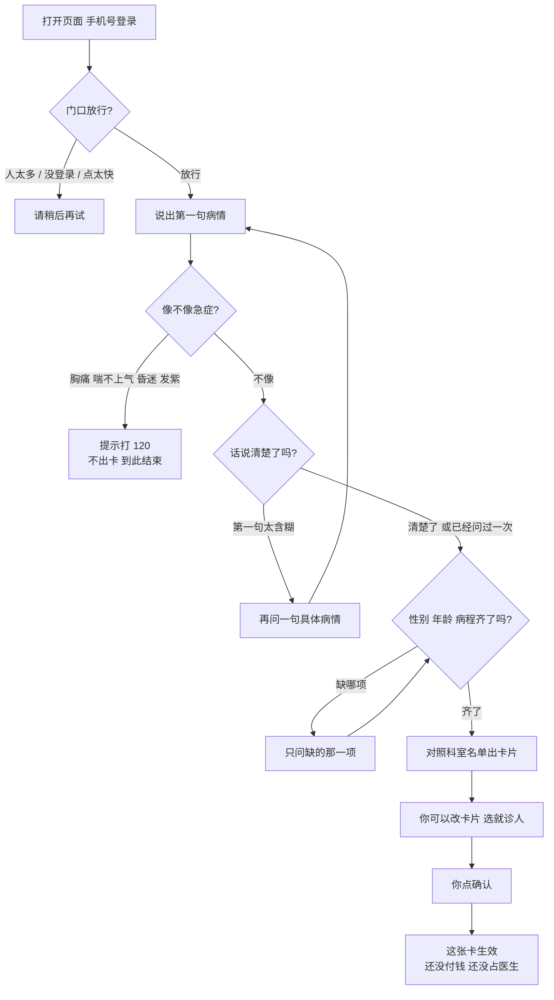
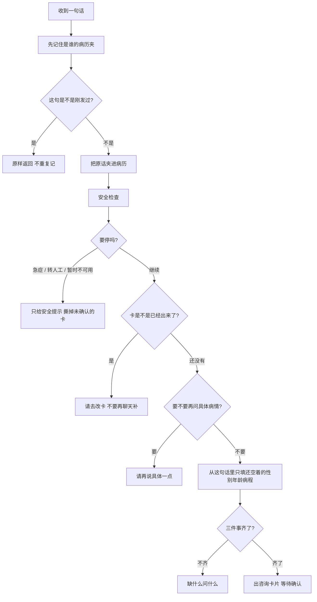
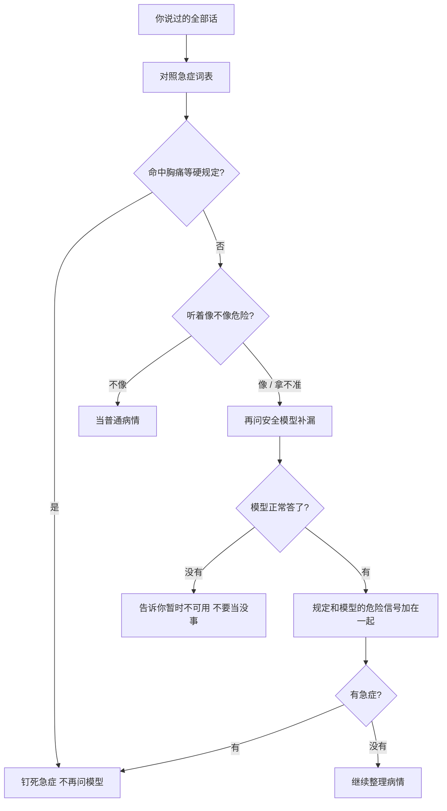
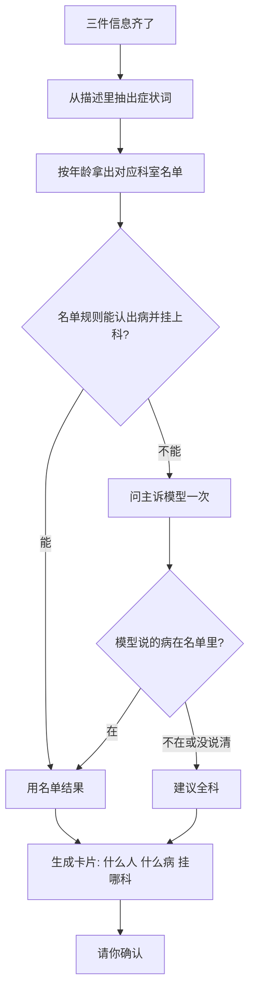
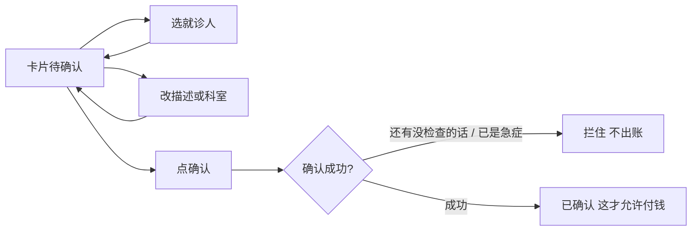
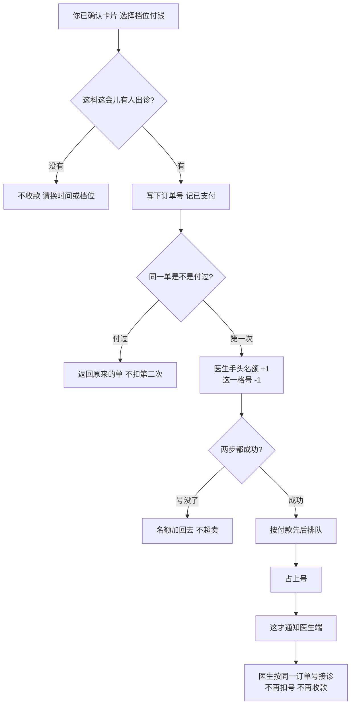
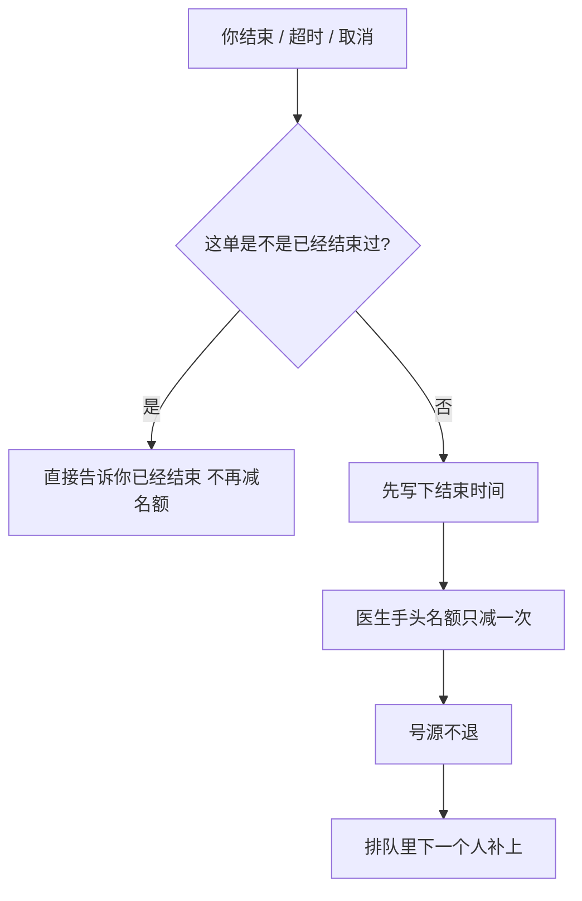
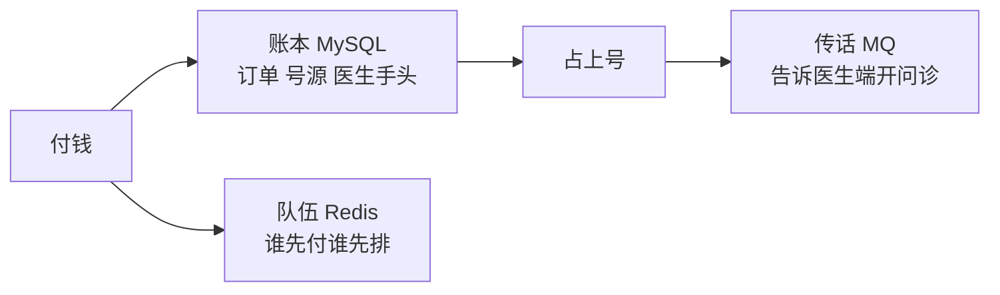

# 导诊挂号助手

患者用自然语言描述病情。系统先看是不是急症，再问清楚、推荐科室、出一张咨询卡片。你确认并付钱之后，才去占医生号、交给医生。问诊由医生完成，本服务不代替大夫看病。

本仓库是 [moonligh](https://moonligh.cn/) 的个人开源项目，采用 [Apache-2.0](LICENSE) 许可证。GitHub 仓库名 `consult`。

## 一句话

**付钱之前只整理病情、不出号；付钱之后用同一张订单号扣库存、派医生。** 急症直接劝去打 120，不出卡。

## 实现到哪

挂号这一段（进门说话 → 出卡确认 → 演示下单 → 派医生）已经能跑通。还没接真实微信/支付宝、还没有医生端 App、号源是示例不是医院 HIS。

## 口述：从进门到付钱之前

先记住：**这时候还没付钱，也不占医生号。** 系统只是在跟你说话，把病情问清楚，出一张你可以确认的卡片。这一轮咨询有一个编号，像病历夹，你说的每句话都夹进去。

打开页面，手机号收验证码登录。门口先看人多不多、你是不是本人、是不是连点太快。进门后你说第一句病情。系统**先问有没有要命的事**：胸痛、喘不上气、昏迷、嘴唇发紫，直接告诉你打 120，不出挂号卡。不是急症，但你只说「有点不舒服」，它会再问一句具体哪儿不舒服；你再说还是含糊，就不再死问，继续往下。接着补三件小事：性别、年龄、病了多久，缺哪个问哪个。齐了以后对照科室名单：小孩走儿科、大人走成人科，对不上就建议全科，**绝不瞎编科室**。卡片出来后，你可以改描述、改科室、选家里哪位就诊人。点确认，才算「这张卡我认了」。页面上虽然能看到选档付钱，**没确认，后台一律不收款**。



### 你每说一句，后台在干什么

双击发送也没关系：同一句话带同一张小票，第二次直接给你看现在的画面，不会记两遍。危险不危险先算完，再去改病历夹，免得改夹子的时候干等好几秒。急症一旦认定，后面再说「好多了」也撤不掉。



### 急症怎么判

先对死规定，再决定要不要问大模型。规定说急症，大模型不准改口。拿不准或模型挂了，当成「先按安全处理」，**绝不默认没事**。



### 卡片怎么出来

性别、年龄、病程齐了才出卡。科室只能来自医院名单：儿童和成人两套，对不上就建议全科。



### 确认之前你还能做什么

- 选家里哪位就诊人：性别年龄以档案为准；小孩和大人名单不一样时，科室会重算。
- 改卡片上的描述：会再查一遍急症，改出急症就把卡作废。
- 自己改科室：以你选的为准。
- 看到四档价格：只是价目表，**点确认之前不会扣钱**。



## 口述：付钱成功以后

钱到了，不先喊医生，先用 **订单号** 把钱和号对齐，跟电商下单锁库存一个道理。

医生这边其实有两样「货」：

- **这一格号**：卖掉就不退回去，像电影票撕了就不能再卖同一张。
- **医生手头同时能看几个人**：看完或超时，名额腾出来给下一位排队的人。

没号先不收款。收了款才占这两样。暂时没医生，就按谁先付钱谁先排。占上号之后，才通知医生端开问诊。取消或超时：问诊结束，腾出医生手头名额，那张号不退。演示环境是点下单就算已支付，真实微信/支付宝以后再接。



取消怎么走：先把这张单打成「已结束」，再把医生手头名额还一次。还失败了，定时任务会把过期的占号扫掉。号源不退回货架。



## 三样东西怎么分工（还是大白话）

付钱开始，账本、队伍、传话各管各的：



- **账本（MySQL）**：钱和号以它为准。它挂了宁可先不卖，也不能超卖。
- **队伍（Redis）**：防止连点、帮人排队。它挂了还能下单，只是排队要事后对账。
- **传话（消息队列）**：号已经占上了才喊医生。喊失败了以后补喊，医生按订单号认人，不会开两份。

门口还有人流限制：人挤爆了请稍候，刷太快请慢一点。大模型忙不过来，安全侧按「先当危险处理」，分科侧按规则走，不会卡住整条街。

## 本地怎么跑

JDK 21，本机 MySQL 库 `consult_agent`，再加 Redis。密钥写在不进 git 的 `application-local.yml`。

```text
mvn -B verify
mvn -B -pl consult-gateway -am spring-boot:run
mvn -B -pl consult-identity/consult-identity-service -am spring-boot:run
mvn -B -pl consult-registration-agent/consult-registration-agent-service -am spring-boot:run
```

| 谁 | 端口 |
| --- | --- |
| 门口（网关） | 8080 |
| 导诊挂号 | 18081 |
| 登录和号源 | 18082 |
| 患者页面 | `consult-registration-web` |

## 仓库里有什么

```text
consult-gateway/                 门口：登录检查、人流限制
consult-identity/                登录、家里的就诊人、医生号源
consult-registration-agent/      说话、出卡、下单占号
consult-framework/               大家共用的锁、模型配额、发消息
consult-registration-web/        患者页面
docs/合规/                       能做什么、不能做什么
docs/对齐/                       并发、评测、主诉怎么挂科
docs/观测/                       事后抽查看话术
```

医生端以后会再加一对服务。科室和号源是示例，真实医院系统还没接。

## 路线图

- [x] 急症分流、问清楚、出卡片
- [x] 登录门口、身份和挂号拆开
- [x] 按年龄选科室名单
- [x] 演示下单、占号、排队、通知医生
- [x] 事后抽查看话术（默认关掉）
- [ ] 真支付、真退款
- [ ] 医生端接诊
- [ ] 真实医院号源；急症口语经医生审核后再强制
- [ ] 生产钥匙和压测

## 声明

本项目提供的是健康信息整理，不能替代执业医师的诊断、分诊或挂号建议。

## 说明

实现以代码为准。边界与验收以 `docs/合规/` 为准，不构成法律意见：

- [互联网诊疗服务边界调研报告](docs/合规/互联网诊疗服务边界调研报告.md)
- [合规边界与适用场景评估](docs/合规/AI挂号助手合规边界与适用场景评估.md)
- [风险识别与安全处置](docs/合规/AI导诊风险识别与安全处置规范.md)
- [数据与大模型调用](docs/合规/医疗健康数据与大模型调用合规规范.md)
- [安全测试与上线验收](docs/合规/AI挂号助手安全测试与上线验收标准.md)

工程展开：[千并发部署与限流](docs/对齐/千并发企业级部署与限流方案.md)、[主诉归约](docs/对齐/主诉归约全链路企业级方案.md)、[导诊评测](docs/对齐/导诊评测完整方案.md)。

要对照源码时，从 `ConsultationController`（发消息）、`ConsultationService.acceptLocked`（每一句话的顺序）、`SafetyGate`（急症）、`TriageEngine`（出卡）、`placeOrderLocked`（付钱）看起。

## 参与贡献

贡献方式见 [CONTRIBUTING.md](CONTRIBUTING.md)，行为准则见 [CODE_OF_CONDUCT.md](CODE_OF_CONDUCT.md)。安全问题见 [SECURITY.md](SECURITY.md)，请不要把漏洞细节写进公开 Issue。

## 许可证

Copyright 2026 moonligh

本项目使用 Apache License 2.0，全文见 [LICENSE](LICENSE)。
