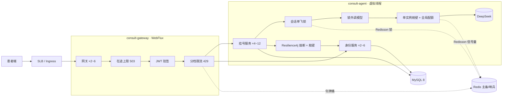

# 千并发企业级部署与限流方案

## 1. 目标口径

| 指标 | 目标 |
|---|---|
| 峰值并发 | **同时在途 1000 个请求**（比"1000 人在线"严格得多：在线用户大部分时间在打字，在途数通常只有在线数的 1/5~1/3） |
| 咨询消息延迟 | p95 < 5s，p99 < 8s（含模型调用） |
| 错误率 | HTTP 失败 < 1%；被限流/削峰的请求返回 429/503 和 `Result` JSON，前端提示稍后重试 |
| 可用性 | 任一服务单副本故障、Redis 故障、身份服务变慢时不丢单、不雪崩 |

按 Little 定律（并发 = 吞吐 × 平均耗时）：一条咨询消息平均约 2.5s（安全模型 + 主诉模型，各约 1.2s），
1000 在途 ≈ **400 条消息/秒**。下单约为消息量的 1/10，≈ 40 单/秒。

## 2. 架构

## 3. 分层保护

请求从外到内经过五层，每层挡不同的东西，超限后的行为也不同：

| 层 | 组件 | 挡什么 | 默认阈值 | 超限行为 |
|---|---|---|---|---|
| 1 网关在途上限 | `InFlightLimitGatewayFilter` | 洪峰：活动、故障恢复后的集中重试 | 单实例 1500（2 副本 3000） | 503 + `SERVICE_BUSY(1004)`，不验令牌、不碰 Redis |
| 2 网关分档限流 | `RateLimitGatewayFilter` + Spring Cloud Gateway `RedisRateLimiter`（官方 Lua 令牌桶） | 刷子、脚本、连点；集群内共享计数 | 短信 2/s·IP，登录 5/s·IP，咨询写 2/s·账号，其余 5/s | 429 + `TOO_MANY_REQUESTS(1003)`；Redis 故障时 5 秒内退回本实例内存桶 |
| 3 会话单飞 | `RedissonConsultationGuard`（Redisson `RLock`，不等待、20s 租期） | 同一轮咨询重复提交（双击、客户端超时重试）导致模型和派单跑两遍 | 每会话 1 个在跑 | 业务码 `CONSULT_IN_PROGRESS(1127)`；Redis 故障放行，行锁兜底 |
| 4 模型并发 | `ModelGateway` 单实例信号量 + `RedissonModelQuota`（Redisson 可过期信号量） | 供应商账号并发上限；副本扩容后总并发不超额 | 安全 全局 600 / 单实例 200；主诉 全局 400 / 单实例 130 | 排队最多 1.5s / 0.8s，再拿不到判 BUSY → 安全兜底 / 规则分诊；许可带租期，宕机自动回收 |
| 5 下游身份服务 | Resilience4j `CircuitBreaker` + `Bulkhead`（`ResilienceInterceptor`） | 身份服务变慢拖住挂号服务 | 舱壁单实例 100 并发、排队 200ms；50 次中失败或 >2s 慢调用过半熔断 10s | 快速失败 → `DOCTOR_UNAVAILABLE`，订单已落库，可重派 |

另有两道底线：数据库连接池拿连接超时 3s、行锁等待 5s；网关到后端响应超时 15s。

## 4. 容量计算

| 资源 | 计算 | 结论 |
|---|---|---|
| 模型并发 | 400 消息/s × 平均 1.6 次调用 × 1.2s ≈ 770 | 安全 600 + 主诉 400 = 1000 全局配额，留 30% 余量。**需向 DeepSeek 确认账号并发 ≥ 1000** |
| 挂号服务副本 | 单副本 250 在途（虚拟线程无线程瓶颈），按 CPU 扩 | 最少 4、最多 12；单实例模型上限 × 最少副本 ≥ 全局配额 |
| 数据库连接 | 每条消息锁内短事务约 15ms + 草稿读 5ms：400 × 0.02 ≈ 8 个连接在用 | 单副本 30 足够；总量 12×30 + 6×20 = 480，MySQL `max_connections` ≥ 1000 |
| 数据库 TPS | 每条消息约 6 条语句 | 约 2400 QPS 写读混合，4C16G MySQL 8 足够，主从 + 半同步 |
| Redis | 网关 1 次 Lua + 单飞 2 次 + 每次模型调用 2 次 + 缓存读写 | 约 4000 ops/s，主备或哨兵即可；单次超时 300ms（网关）/ 1s（挂号） |
| 网关 | Netty 非阻塞，1000 并发 CPU 很低 | 2 副本为高可用，HPA 到 6 |
| 身份服务 | 40 单/s 派单 + 登录 | 2 副本，HPA 到 6 |

## 5. 组件选型

| 组件 | 用途 | 为什么 |
|---|---|---|
| Spring Cloud Gateway `RedisRateLimiter` | 网关集群限流 | 官方实现、Lua 原子令牌桶；自定义过滤器只负责分档、取键、JSON 返回和故障退回 |
| Redisson 4.3 | 全局模型配额、会话单飞锁 | `RPermitExpirableSemaphore` 带租期，实例宕机许可自动回收；`RLock` 带租期不怕死锁；懒连接，Redis 起不来服务照常启动 |
| Resilience4j 2.3 | 身份服务熔断 + 舱壁 | 业界标准，接 Micrometer 出 `resilience4j_*` 指标；只用核心模块，不依赖 Spring Boot starter 适配版本 |
| Micrometer + Prometheus | 指标 | 三个服务统一 `/actuator/prometheus`，带 `application` 标签 |
| Kubernetes HPA / PDB / 拓扑分散 | 弹性与高可用 | 扩容不等待、缩容等 10 分钟，避免高峰抖动；PDB 保证滚动和节点维护时副本数 |
| k6 + WireMock | 压测 | k6 脚本化、阈值即验收标准；WireMock 模拟模型延迟分布，压测不打真实账号 |

没有选 Sentinel：它需要单独的控制台和 Spring Cloud Alibaba 适配，当前需求（集群限流、并发配额、熔断）Redis + Resilience4j 已覆盖。
需要运营在控制台实时改规则时再引入。

## 6. 配置清单

部署清单在 `deploy/k8s/`，镜像用根目录 `Dockerfile` 的 `MODULE` 参数分别构建。关键环境变量：

| 服务 | 变量 | 生产值 | 说明 |
|---|---|---|---|
| 公共 | `AUTH_SMS_DEV_CODE` | **空** | 非空时固定码对任何手机号都能登录，只有压测环境设 `000000` |
| 网关 | `GATEWAY_MAX_IN_FLIGHT` | 1500 | 单实例在途上限 |
| 网关 | `GATEWAY_TRUSTED_PROXY_HOPS` | 1 | 前面代理层数，限流按真实客户端 IP |
| 网关 | `GATEWAY_RATE_LIMIT_*` | 见 yml | 各档 per-second / burst |
| 网关 | `GATEWAY_RESPONSE_TIMEOUT` | 15s | 到后端的响应超时 |
| 挂号 | `MODEL_SAFETY_GLOBAL_CONCURRENCY` / `MODEL_COMPLAINT_GLOBAL_CONCURRENCY` | 600 / 400 | 全局配额，0 关闭 |
| 挂号 | `MODEL_SAFETY_CONCURRENCY` / `MODEL_COMPLAINT_CONCURRENCY` | 200 / 130 | 单实例舱壁 |
| 挂号 | `MODEL_BASE_URL` | DeepSeek | 压测指向 WireMock |
| 挂号 | `IDENTITY_MAX_CONCURRENCY` | 100 | 打身份服务的舱壁 |
| 挂号 | `CONSULT_GUARD_LEASE` | 20s | 单飞锁租期，要大于一次请求最坏耗时 |
| 挂号 | `REDISSON_CONFIG_FILE` | 哨兵/集群时给 | Redisson YAML 路径 |
| 身份 | `SERVER_ADDRESS` | 0.0.0.0 | 容器内监听；NetworkPolicy 只放行网关和挂号服务 |

## 7. 监控与告警

| 指标 | 告警条件 | 含义 |
|---|---|---|
| `gateway_shed_total` | 5 分钟内 > 0 持续 | 网关在削峰：扩网关或查后端为何变慢 |
| `gateway_rate_limited_total{tier}` | 某档突增 | 刷子或阈值过紧 |
| `gateway_in_flight_requests` | > 上限 70% | 接近削峰 |
| `triage_model_calls_total{status="BUSY"}` 占比 | > 2% | 模型配额不够或供应商变慢 |
| `triage_model_quota_total{outcome="bypass"}` | > 0 | Redis 故障，全局配额退化为单实例 |
| `triage_model_latency` p95 | > 2s | 供应商变慢，先于用户投诉发现 |
| `consult_inflight_guard_total{outcome="rejected"}` | 占比 > 1% | 前端重复提交 |
| `resilience4j_circuitbreaker_state{name="identity",state="open"}` | = 1 | 身份服务故障 |
| `hikaricp_connections_pending` | > 0 持续 1 分钟 | 连接池不够或慢 SQL |
| `http_server_requests_seconds` p99 | > 8s | 总体延迟超标 |

## 8. 压测与验收

1. 准备压测环境：独立库或影子库；身份服务 `AUTH_SMS_DEV_CODE=000000`。
2. 起模拟模型：`docker run -p 9090:8080 -v $PWD/loadtest/wiremock:/home/wiremock wiremock/wiremock --container-threads 2000 --async-response-enabled true`，
   挂号服务 `MODEL_BASE_URL=http://wiremock:9090`。中位延迟 1.2s 的对数正态分布，接近线上。
3. 跑 `k6 run -e BASE_URL=http://<网关> -e THINK_MS=0 loadtest/k6/consult-1000.js`（`THINK_MS=0` 时在途 ≈ VU 数）。
4. 验收：k6 阈值全部通过（失败率 < 1%、消息 p95 < 5s、削峰 < 100 次）；压测期间 `hikaricp_connections_pending` 为 0、
   模型 BUSY 占比 < 2%、HPA 扩容在 2 分钟内完成。
5. 故障演练：压测中分别停 Redis、停一个身份服务副本、给 WireMock 加 5s 延迟，确认错误率仍在阈值内、无请求挂死。

## 9. 上线检查

- [ ] 执行 `migrate-capacity.sql`（挂号、身份各一份）
- [ ] `AUTH_SMS_DEV_CODE` 为空、密钥全部走 Secret 且已替换占位值
- [ ] MySQL `max_connections` ≥ 1000；Redis 主备或哨兵
- [ ] 向 DeepSeek 确认账号并发 / RPM 限额，据此设全局配额
- [ ] Prometheus 抓取三个服务，第 7 节告警已配置
- [ ] 压测与故障演练报告通过

## 10. 后续演进

| 时机 | 做什么 |
|---|---|
| 消息量再翻倍、MySQL 写成为瓶颈 | 决策表、审计表改为 MQ（RocketMQ / Kafka）异步落库，主链路只写会话和订单 |
| 管理端报表变慢 | 报表查询走只读从库 |
| 运营需要实时调规则 | 引入 Sentinel 控制台或把限流规则放配置中心（Nacos）热更新 |
| 多机房 | Redis、MySQL 跨可用区；网关前置全局负载均衡 |
